<!--
  © 2026 Aaradhya Rawat. All rights reserved.
  This profile's design, artwork and code are original work and are not licensed for reuse. See LICENSE.
  This file is published automatically; manual edits are overwritten, except the game board block.
-->


 

<picture><source media="(prefers-color-scheme: dark)" srcset="https://raw.githubusercontent.com/Aadi-web-op/Aadi-web-op/main/assets/headers/about-dark.svg"></picture>


<picture><source media="(prefers-color-scheme: dark)" srcset="https://raw.githubusercontent.com/Aadi-web-op/Aadi-web-op/main/assets/headers/coming-soon-dark.svg"></picture>

<a href="https://www.linkedin.com/posts/aaradhya-rawat-609a6a327_buildinpublic-ai-productivity-ugcPost-7521194593791574016-8-FP/"></a>

<b>▶ Watch the full teaser</b>

 

<!-- To get an inline player: edit README.md on github.com, drag the 16:9 teaser .mp4 onto the line below, then commit. -->

Prefer LinkedIn? [Watch it there](https://www.linkedin.com/posts/aaradhya-rawat-609a6a327_buildinpublic-ai-productivity-ugcPost-7521194593791574016-8-FP/).

<picture><source media="(prefers-color-scheme: dark)" srcset="https://raw.githubusercontent.com/Aadi-web-op/Aadi-web-op/main/assets/headers/work-dark.svg"></picture>

<a href="https://github.com/Aadi-web-op/Pathify"></a>
<a href="https://github.com/Aadi-web-op/Neura-Sentinal"></a>
<a href="https://github.com/Aadi-web-op/Trinetra_New"></a>
<a href="https://github.com/Aadi-web-op/Honeypot-API21"></a>

<picture><source media="(prefers-color-scheme: dark)" srcset="https://raw.githubusercontent.com/Aadi-web-op/Aadi-web-op/main/assets/headers/milestones-dark.svg"></picture>


<picture><source media="(prefers-color-scheme: dark)" srcset="https://raw.githubusercontent.com/Aadi-web-op/Aadi-web-op/main/assets/headers/toolbox-dark.svg"></picture>


<picture><source media="(prefers-color-scheme: dark)" srcset="https://raw.githubusercontent.com/Aadi-web-op/Aadi-web-op/main/assets/headers/contributions-dark.svg"></picture>

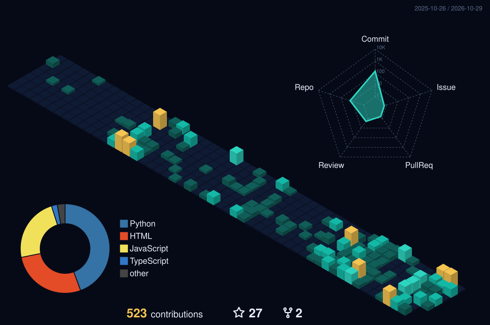


<picture><source media="(prefers-color-scheme: dark)" srcset="https://raw.githubusercontent.com/Aadi-web-op/Aadi-web-op/main/assets/headers/problem-solving-dark.svg"></picture>

<a href="https://leetcode.com/u/Aaradhya_Rawat/"></a>

<picture><source media="(prefers-color-scheme: dark)" srcset="https://raw.githubusercontent.com/Aadi-web-op/Aadi-web-op/main/assets/headers/play-dark.svg"></picture>

<!-- BEGIN:ttt -->

 
 

<b>Your move.</b> Click any empty square to start a game.

You are <b>X</b>. The AI plays <b>O</b> with minimax: it searches every possible game before it moves, so it never loses. 
Each click opens a pre-filled issue. A GitHub Action plays the AI's reply and updates this board. 
Scoreboard: Humans <b>0</b> · AI <b>1</b> · Draws <b>0</b> Recent games: @Aadi-web-op (lost)

<!-- END:ttt -->

<picture><source media="(prefers-color-scheme: dark)" srcset="https://raw.githubusercontent.com/Aadi-web-op/Aadi-web-op/main/assets/headers/bigo-one-dark.svg"></picture>

<!-- BEGIN:videos -->

<a href="https://www.youtube.com/watch?v=YumjMXDYz2o"></a>
<a href="https://www.youtube.com/watch?v=eH6qtbDKBk8"></a>
<a href="https://www.youtube.com/watch?v=8__NAZXPwHQ"></a>

<a href="https://www.youtube.com/@BigOOne-dsa"><b>More DSA walkthroughs on BigO One →</b></a>

<!-- END:videos -->

<picture><source media="(prefers-color-scheme: dark)" srcset="https://raw.githubusercontent.com/Aadi-web-op/Aadi-web-op/main/assets/headers/activity-dark.svg"></picture>

<!-- BEGIN:activity -->
- <code>Oct 13</code>&nbsp; Open-sourced [DSA-PREP-CONTENT](https://github.com/Aadi-web-op/DSA-PREP-CONTENT)
- <code>May 6</code>&nbsp; Shipped updates to [Trinetra-IVthSem-Project](https://github.com/Aadi-web-op/Trinetra-IVthSem-Project)
- <code>Apr 25</code>&nbsp; Shipped updates to [HoneyPot_Portal](https://github.com/Aadi-web-op/HoneyPot_Portal)
- <code>Apr 11</code>&nbsp; Shipped updates to [Trinetra_New](https://github.com/Aadi-web-op/Trinetra_New)
- <code>Mar 20</code>&nbsp; Shipped updates to [EduManage](https://github.com/Aadi-web-op/EduManage)
- <code>Feb 20</code>&nbsp; Shipped updates to [honeypot-api](https://github.com/Aadi-web-op/honeypot-api)
<!-- END:activity -->

 

<picture><source media="(prefers-color-scheme: dark)" srcset="https://raw.githubusercontent.com/Aadi-web-op/Aadi-web-op/main/assets/footer-dark.svg"></picture>

